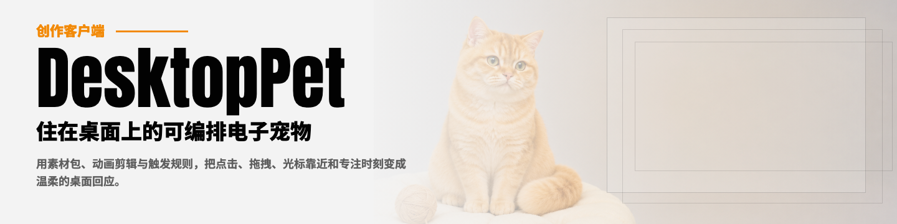
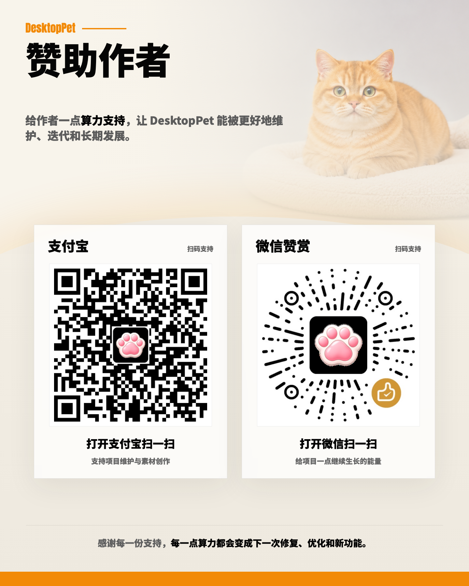

# Desktop Pet



一个跨平台的 Electron 桌面宠物客户端。它把透明无边框的宠物窗口放在桌面上，并通过 `.petpack` 素材包、动画剪辑和触发规则，把点击、拖拽、全局鼠标移动、定时、番茄钟等事件组合成可配置的互动行为。

## 功能特性

- **本地桌宠窗口**：默认 320×320、透明背景、无边框、置顶显示；控制面板为独立窗口，用于管理素材和规则。
- **Petpack 素材包**：导入/导出 `.petpack`，包内包含 `manifest.json` 与素材文件；安装在 Electron `userData` 的 `packages/{packageId}/` 下。
- **动画系统**：支持 default / oneshot / loop / keyframe 剪辑，素材格式包括 GIF、WebP、WebM、MP4、MOV、PNG、SVG。
- **非打断动画队列**：oneshot 和 loop 受保护时不会被普通请求打断；队列使用单个 pending 槽位，最新请求覆盖旧请求。
- **关键帧和全局鼠标互动**：支持用全局鼠标距离、方向、角度进度等参数驱动关键帧动画；角度进度映射为上方 0、右侧 0.25、下方 0.5、左侧 0.75。
- **规则引擎**：用条件、过滤器、优先级、冷却、连续触发、随机/顺序动作和退出动作组合行为。
- **控制面板**：管理资源、动画、触发规则、显示设置、系统设置、日志和语言。
- **实时生效**：面板保存配置后，主进程持久化并广播运行时更新，宠物窗口会重建运行时而无需重启。
- **安全机制**：Context Isolation、受控 preload API、路径安全校验、符号链接拒绝、动态资源耗尽保护和原子写入/安装。
- **双语界面**：内置中文和英文，支持缺省回退与简单参数插值。

## 快速开始

```bash
npm install
npm run dev
```

`npm run dev` 会以 Electron 开发模式启动应用。首次运行后，可以通过右键宠物或系统托盘打开控制面板。

## 常用命令

```bash
# 开发
npm run dev              # 启动 Electron 应用
npm run landing:dev      # 启动官网/手册页面的 Vite 开发服务

# 测试
npm test                 # 运行 Vitest 单元测试
npm run test:watch       # 以 watch 模式运行单元测试
npm run test:e2e         # 运行 Playwright E2E（含 Electron smoke）
npm run test:e2e:ci      # CI/headless E2E，跳过 Electron smoke

# 构建
npm run build            # 构建 Electron renderer
npm run landing:build    # 构建 landing/ 到 dist/pages
npm run pack             # 打包应用目录，不生成安装器
npm run dist             # 生成可分发安装器
```

## 项目结构

```text
desktop-pet/
├── src/
│   ├── main/                 # Electron 主进程、窗口、IPC、托盘、全局鼠标追踪
│   │   ├── main.js
│   │   ├── ipc.js
│   │   ├── windows.js
│   │   ├── global-mouse-tracker.js
│   │   └── services/         # config-store、asset-store、petpack、logger
│   ├── preload/              # contextBridge 暴露的受控 API
│   ├── renderer/
│   │   ├── pet/              # 宠物窗口、动画、媒体渲染、规则运行时
│   │   └── panel/            # 控制面板模块化 UI
│   └── shared/               # schema、规则引擎、校验、i18n、工具
├── landing/                  # 官网和在线使用手册页面
├── tests/                    # Vitest / Playwright 测试
├── docs/                     # 架构、使用和发布文档
└── dist/                     # 构建产物
```

更完整的架构说明见 [docs/architecture/current-architecture.md](docs/architecture/current-architecture.md)。

## Electron 运行模型

Desktop Pet 是三进程 Electron 应用：

1. **Main Process**（`src/main/`）
   - 创建宠物窗口、控制面板窗口和系统托盘。
   - 通过 IPC 管理配置、素材、petpack、显示和系统设置。
   - 负责本地文件读写、全局鼠标追踪、原子安装/导出等需要 Node.js 能力的工作。
2. **Preload Scripts**（`src/preload/`）
   - 使用 `contextBridge` 暴露 `window.desktopPet` 和 `window.desktopPetPanel`。
   - renderer 不能直接访问 Node.js，只能通过受控 API 调用主进程。
3. **Renderer Processes**（`src/renderer/`）
   - `pet/` 负责宠物窗口渲染、事件上下文构建、规则运行时和动作执行。
   - `panel/` 负责控制面板 UI、表单解析、配置保存和运行时状态展示。

## Petpack 格式

`.petpack` 是 ZIP 文件，根目录包含 `manifest.json` 和素材文件：

```text
my-pet.petpack
├── manifest.json
└── assets/
    ├── idle.svg
    ├── click.gif
    └── follow.webm
```

当前 manifest 使用 `schemaVersion: 1`，核心字段包括 `packageId`、`name`、`version`、`animations` 和 `triggerRules`：

```json
{
  "schemaVersion": 1,
  "packageId": "my-pet",
  "name": "My Pet",
  "version": "1.0.0",
  "animations": {
    "default": {
      "id": "11111111-1111-4111-8111-111111111111",
      "name": "Idle",
      "asset": "assets/idle.svg",
      "type": "default"
    },
    "clips": [
      {
        "id": "22222222-2222-4222-8222-222222222222",
        "name": "Click",
        "asset": "assets/click.gif",
        "type": "oneshot",
        "durationMs": 900
      }
    ]
  },
  "triggerRules": [
    {
      "id": "click-greeting",
      "name": "Click greeting",
      "enabled": true,
      "conditions": [
        {
          "type": "click",
          "filters": [{ "field": "distanceToPetCenter", "operator": "<", "value": 180 }]
        }
      ],
      "priority": 50,
      "cooldownMs": 1000,
      "actions": [
        { "type": "playAnimation", "animation": "22222222-2222-4222-8222-222222222222", "durationMs": 900 },
        { "type": "showMessage", "text": "Hi there!", "durationMs": 1800 }
      ]
    }
  ]
}
```

导入流程会校验 ZIP 结构、路径和素材扩展名，拒绝符号链接和不安全路径，使用动态内存/磁盘资源保护，并在 manifest 校验通过后以临时目录 → 备份旧包 → 原子替换的方式安装；失败时会回滚。导出时会把当前用户配置中的动画、触发规则和互动设置合并回 manifest，再校验并原子写出 ZIP。

制作说明见 [docs/USER_GUIDE.md](docs/USER_GUIDE.md)，在线页面见 `landing/manual.html`。

## 动画系统和队列

动画剪辑类型：

- `default`：默认循环动画，作为空闲或回退状态。
- `oneshot`：播放一次，通常用于点击、抓起、放下等短反馈。
- `loop`：循环播放，直到被停止或被队列切换。
- `keyframe`：媒体暂停在指定进度，由 `setKeyframeProgress` 或带进度的关键帧播放驱动。

普通 `playAnimation` 使用非打断、单槽位、最新优先的队列模型：

- 正在播放且受保护的 `oneshot`（仍在 `durationMs` 内）或 `loop` 不会被普通请求立即打断。
- 受保护期间的新请求进入单个 pending 槽位；后来的请求会覆盖旧 pending。
- 请求与当前 active clip 相同会被忽略，避免重复排队。
- active clip 完成后，如果有 pending 就播放 pending，否则返回 default。
- `interrupt: true` 的剪辑会绕过保护，立即清空计时器和 pending 并播放。
- `setKeyframeProgress` 是连续鼠标驱动的例外：它会立即生效并清空 pending。
- 配置热更新时，如果 active/pending 剪辑被删除会安全回到 default；如果仍存在，会重新指向更新后的剪辑字段。

`oneshot` 剪辑还可以带 `movement` 配置，把移动绑定到动画生命周期上。移动支持方向、速度、`linear` / `easeIn` / `easeOut` / `easeInOut` 预设、强度以及起止延迟；它与独立的 `movePet` 动作分开执行。

## 规则引擎

规则由 `conditions` 和 `actions` 组成。宠物 renderer 不把用户规则注册到历史 `EventBus`；当前运行路径是：

```text
pet.js 构建事件上下文
→ ruleRuntime.evaluateEvent(context) 记录最近事件、匹配规则、处理优先级/冷却/状态
→ pet.js 执行动作序列；只有 delay 动作会把后续动作延后
→ UserTriggerManager.executeAction(action, context) 执行动画、消息、显示、窗口等副作用
```

支持的条件类型：

- 指针：`click`、`doubleClick`、`rightClick`、`mouseEnter`、`mouseLeave`、`mouseMove`、`mouseStill`
- 拖拽：`dragStart`、`dragging`、`dragEnd`
- 时长：`hoverDuration`、`idleDuration`
- 定时：`timer`、`randomTimer`
- 生命周期/系统：`appLaunch`、`packageLoaded`、`pomodoroComplete`

过滤器支持 `=`、`!=`、`>`、`>=`、`<`、`<=`、`between`、`in`、`notIn`。

匹配语义：

- required 条件（默认）必须全部在 `conditionWindowMs` 内命中，默认窗口为 1000ms。
- optional 条件（`required: false`）会组成可选组；如果配置了可选条件，则至少需要命中其中一个。
- 规则按 `priority` 从高到低排序；默认命中一条后停止，`stopOnMatch: false` 可继续匹配后续规则。
- `cooldownMs` 按规则记录冷却，防止高频事件刷屏。
- `continuous: true` 会绕过冷却，适合拖拽、鼠标进度、关键帧 scrub 等连续更新。
- `actionStrategy: "random"` 会随机选一个动作；默认按顺序执行动作数组，只有 `delay` 动作的 `durationMs` 会暂停后续动作。
- 旧格式 `trigger + filters` 会在运行时归一化为 `conditions`。
- 状态型鼠标规则可使用 `sustainMs`、`state.exitConditions` 和 `state.exitActions`，用于悬停、睡觉、拖拽等需要进入/退出状态的互动。

支持的动作类型：

- `blank`
- `delay`
- `playAnimation`
- `setKeyframeProgress`
- `showMessage`
- `randomMessage`
- `changeScale`
- `changeOpacity`
- `movePet`
- `pomodoroTimer`
- `hidePet`
- `showPet`
- `disableInteractions`
- `enableInteractions`
- `resetPosition`
- `openPanel`

关键帧动作可以使用 `progressFrom` / `progressField` 从事件上下文读取进度，并用 `scale`、`offset` 调整。全局鼠标角度常用 `progressFrom: "angleToPetProgress"`；进度会先经过剪辑自己的 `keyframes` 映射后再应用到媒体。

## 控制面板

控制面板由 6 个长期标签页组成，旧版 States / Actions 标签页已不再注册：

- **Overview**：当前包、动画/规则/素材统计、运行时状态和最近事件。
- **Assets**：导入、替换、删除素材，导入/导出 petpack。
- **Animations**：配置默认动画和 oneshot / loop / keyframe 剪辑、关键帧映射、绿幕处理和剪辑移动。
- **Rules**：编辑条件、过滤器、执行动作、退出条件、退出动作和冲突提示。
- **Display**：缩放、透明度、置顶、鼠标穿透、锁定、位置重置。
- **System**：语言、开机启动、日志设置和日志查看。

配置更新流：

```text
Panel 表单保存
→ config:save IPC
→ Main 深合并默认配置并写入 config.json
→ Main 重新加载当前包并广播 pet:runtime-updated
→ Pet renderer 重建运行时模型、清理旧 timer、调度新 timer
```

模块化细节见 [docs/panel-architecture.md](docs/panel-architecture.md)。

## 安全机制

- Renderer 进程启用 Context Isolation，禁用 Node Integration。
- Preload 只暴露受控 API，IPC handler 返回 `{ ok, error? }` 风格结果。
- 文件导入依赖系统文件选择器授权，并通过 sender ID 跟踪审批来源。
- 路径安全层拒绝绝对路径、反斜杠、URL scheme、`.` / `..` 片段和 POSIX 归一化后的逃逸路径。
- Petpack 导入拒绝符号链接和不支持的扩展名，使用动态资源保护而不是固定单文件/总包/条目数限制。
- Manifest 校验 schema version、动画资源引用、条件字段、动作类型和动作到动画的引用。
- 配置写入、包安装、导出均采用临时文件/目录 + 原子替换；包安装失败会回滚。
- 分享内容默认是静态资源和 JSON 规则，没有脚本执行入口。

## 配置、包和日志位置

配置保存在 Electron `userData` 目录：

- macOS：`~/Library/Application Support/Desktop Pet/config.json`
- Windows：`%APPDATA%\Desktop Pet\config.json`
- Linux：`~/.config/Desktop Pet/config.json`

导入后的素材包保存在：

```text
{userData}/packages/{packageId}/
├── manifest.json
└── assets/
```

日志由 `src/main/services/logger.js` 管理，可在控制面板 System 标签页调整级别并查看日志文件。

## Landing 和在线手册

`landing/` 是独立的 Vite 站点，包含产品首页和使用手册：

- `landing/index.html`：GitHub Pages 风格首页。
- `landing/manual.html`：使用手册、规则示例、素材制作流程和未来计划。
- `landing/src/`：页面样式和滚动/弹窗脚本。

使用 `npm run landing:dev` 本地预览，使用 `npm run landing:build` 输出到 `dist/pages`。

## 相关文档

- [当前架构](docs/architecture/current-architecture.md)
- [控制面板架构](docs/panel-architecture.md)
- [用户手册](docs/USER_GUIDE.md)
- [产品需求文档](docs/requirements/desktop-client-prd.md)
- [状态型规则设计](docs/stateful-rules-design.md)
- [事件总线历史设计](docs/architecture/event-bus-design.md)
- [动画队列设计](docs/superpowers/specs/2026-07-08-animation-queue-design.md)
- [发布清单](docs/release/client-release-checklist.md)

## 赞助作者

给作者一点算力支持，让 DesktopPet 能被更好地维护、迭代和长期发展。DesktopPet 是免费开源项目，如果它让你的桌面变得更有趣，欢迎请作者喝杯咖啡——每一点支持都会变成下一次修复、优化和新功能。



- 爱发电：<https://www.ifdian.net/a/desktop-pet?utm_source=copylink&utm_medium=link>
- 支付宝 / 微信赞赏：扫描上方二维码。

感谢每一份支持。

## 许可证

本项目采用 GPL-3.0 许可证，详见 [LICENSE](LICENSE)。
